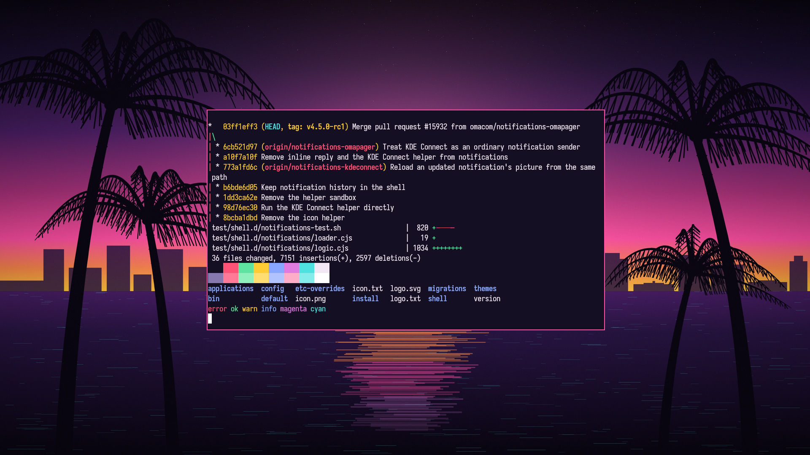

# Leonida

A dark Omarchy theme inspired by the neon sunsets of GTA VI and the state of Leonida: deep indigo night, hot pink, sunset gold and Miami-water aqua.



## Install

```bash
omarchy theme install https://github.com/angbandz/omarchy-leonida-theme
```

## Palette

| Role | Color |
|------|-------|
| Background | `#150f24` |
| Foreground | `#f3e6f5` |
| Accent | `#ff4fa3` |
| Red | `#ff5277` |
| Yellow | `#ffcc33` |
| Orange | `#ff8a4c` |
| Green | `#5fe3a1` |
| Cyan | `#4fe0e0` |
| Blue | `#8aa7ff` |
| Magenta | `#e07be0` |

Every terminal and app config is generated by Omarchy from `colors.toml`. Icons use Yaru-magenta-dark.

## Wallpaper

The sunset wallpaper is original artwork, generated by `tools/make_wallpaper.py` (Python, Pillow and NumPy). Not affiliated with or endorsed by Rockstar Games.
